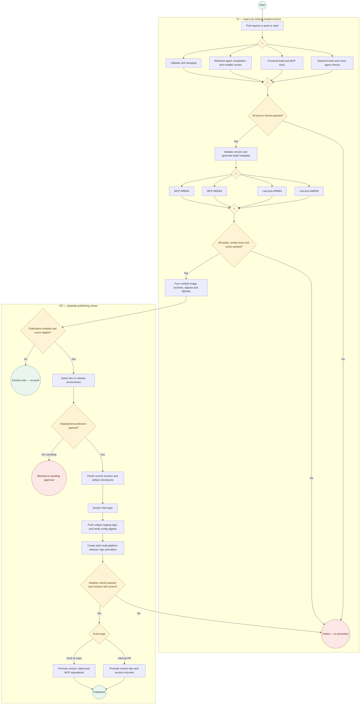
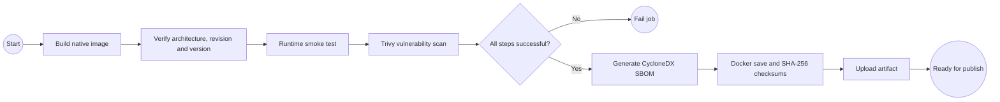

# CI/CD pipeline — automated Docker builds and publication

LanLens uses GitHub Actions to validate source changes, build platform-specific Docker images, check their runtime behaviour and known vulnerabilities, and publish verified images to Docker Hub. Development and stable publication use separate GitHub environments.

**Scope:** This page describes the workflow implementation, not a guarantee that a particular release has been published. Check the individual run's publication job and Docker Hub before deploying a tag.

- [GitHub Actions](https://github.com/AlexRosbach/LanLens/actions)
- [Docker Hub](https://hub.docker.com/r/alexrosbach/lanlens)
- [Workflow source](https://github.com/AlexRosbach/LanLens/tree/main/.github/workflows)

## 1. Process overview (BPMN-inspired)

Circles represent start/end events, rectangles represent activities, diamonds represent gateways, and the plus gateways represent parallel execution and synchronization. This is a BPMN-inspired Mermaid process map, not formal BPMN 2.0 XML.



Each of the four image jobs executes the same gated lifecycle, with product-specific smoke tests:



A failed build or source check prevents the publication job from running. Failures during publication can leave uniquely named staging tags or partially updated public tags; Docker Hub promotion across multiple tags is not transactional. Investigate the failed job before retrying.

## 2. Workflows and responsibilities

| Workflow | Responsibility | Trigger |
|---|---|---|
| `pr-validation.yml` | Orchestrates source checks, builds and runs a separate environment-protected publication job | Pull request; push to main |
| `security.yml` | Gitleaks, Semgrep; additional scheduled source-image scans | Reusable workflow; weekly schedule |
| `docker-build.yml` | Validate version, build and inspect four platform images, smoke-test, scan and export artifacts | Called by PR validation |
| `.github/dependabot.yml` | Propose dependency updates for Python, npm, Docker and Actions | Weekly dependency checks |

No `pull_request_target` workflow is used to build external PR code. No manually dispatched workflow is currently configured; rerun a workflow or submit a new commit when needed.

## 3. Source validation

These checks run in parallel. The image build is downstream of all four source-check groups.

| Check | Method | Purpose |
|---|---|---|
| Backend | Python 3.12, pytest, isolated temporary SQLite DB | Detect functional and regression failures |
| Linux agent | `bash -n` and Python bytecode compilation | Catch installer and agent syntax errors |
| Frontend | Node 22, `npm ci`, production build | Validate TypeScript and bundle generation |
| MCP | Node 22, `npm ci`, `npm test` | Validate MCP server behaviour |
| Windows agent | Windows runner, C# compiler used by the installer, PowerShell parser | Verify compilation and installer syntax |
| Gitleaks | Git history with full checkout | Find potentially committed credentials |
| Semgrep | `p/default`, severity ERROR, blocking mode | Find insecure code patterns |

Tests use temporary credentials and databases, not production credentials or a connection to a deployed LanLens instance. External actions are pinned to explicit commit SHAs, and checkout does not persist Git credentials. The default GitHub token permission is read-only for CI jobs.

## 4. Version and build metadata

The metadata job reads the numeric major.minor.patch version from `backend/version.py` and checks consistency with:

- `frontend/src/version.ts` and `frontend/package.json`
- `mcp/package.json`
- `Dockerfile` and `mcp/Dockerfile`
- `docker-bake.hcl`

A mismatch fails the workflow. When bumping a release, update the version-bearing files and corresponding package lockfiles together.

Build arguments include the application version, GitHub run ID and attempt, source SHA, branch marker (PR number or main) and UTC build timestamp. In a pull request the tested SHA is GitHub's synthetic merge commit, not necessarily the contributor's head commit. Image revision and version labels are inspected after the build.

## 5. Multi-platform Docker build and runtime verification

| Target | Dockerfile | Platforms |
|---|---|---|
| LanLens | `Dockerfile` | linux/amd64, linux/arm64 |
| MCP | `mcp/Dockerfile` | linux/amd64, linux/arm64 |

GitHub-hosted native AMD64 and ARM64 runners execute four independent jobs. Buildx builds the image for the corresponding platform and loads it into the local Docker engine.

LanLens smoke testing imports the backend application using a temporary database and generated key, checks the app title and verifies that build-only pip and ensurepip are absent. MCP smoke testing starts the HTTP server with a temporary API token and checks its loopback health endpoint. Both tests use containers without external network access.

These are smoke tests, not comprehensive production end-to-end tests.

## 6. Image security gate and artifacts

Trivy scans the exact locally built platform image. The blocking policy is **fixable HIGH and CRITICAL findings**: the scanner uses exit code 1 for matching findings and ignores vulnerabilities with no known fix for this gate. Lower severity and unfixed findings still require separate security review; a passing scan does not mean an image has no vulnerabilities.

After the scan succeeds, the runner exports:

| Artifact file | Purpose |
|---|---|
| `image.tar` | The tested and scanned Docker image |
| `config-digest.txt` | Image configuration digest / Docker image ID |
| `sbom.json` | CycloneDX software bill of materials |
| `SHA256SUMS` | Integrity checks for the exported files |

Artifacts are scoped to the workflow run, named per product and architecture, and retained for three days. No Docker Hub token is passed to these jobs.

## 7. Publication authorization and trust boundary

The read-only Docker publication policy job reports repository/event eligibility before publishing. An explicitly disabled variable skips publishing; a missing or invalid variable fails the policy job for eligible events with a configuration message. External PRs remain checks-only. Publication runs only when all required builds succeed and the repository Actions variable `DOCKERHUB_PUBLISH_ENABLED` equals `true`.

The workflow additionally requires the canonical repository and one of:

- A PR targeting main from the same repository, excluding Dependabot as the triggering actor.
- A push to the main branch.

Fork PRs can run CI, subject to GitHub approval settings, but are excluded from publication. The development environment is `dockerhub-dev`; the stable environment is `dockerhub-release`. GitHub deployment protection rules apply before environment secrets become available.

The publishing job is declared directly in the orchestration workflow, rather than calling a reusable publishing workflow, so its environment secrets are resolved without an additional secret-passing boundary. It runs separately and does not check out the source tree or execute the application. It validates the revision against the current PR head/base or main head, verifies artifact checksums and logs in to Docker Hub using an environment secret via standard input.

**Secret handling:** Environment secrets cannot be read back as plaintext through the GitHub UI or API. They can be used by authorized jobs, however. GitHub log masking is not a complete security boundary. Trusted repository writers can modify workflow code, so automatic same-repository PR publication assumes those writers are trusted. A Docker Hub token with write access is not restricted to development tags by the workflow itself; its actual capabilities are determined by Docker Hub permissions.

For stricter owner-only authorization, configure required reviewers on the environments, review workflow changes before approving, and disable administrator bypass where supported. This introduces a manual approval step. Consider a separately protected publishing repository or a restricted staging repository for stronger isolation from contributors.

## 8. Push, signing and promotion

1. Download and validate the four artifacts from the same workflow run.
2. Authenticate with Docker Hub only after the initial artifact checks.
3. Load each scanned image without rebuilding; validate its architecture, revision, version and image ID.
4. Push to a unique `ci-<run>-<attempt>-<target>-<arch>` staging tag.
5. Compare the registry manifest's configuration digest with the locally scanned image ID.
6. Attach the platform SBOM using a Cosign attestation.
7. Assemble the AMD64 and ARM64 digests into a multi-platform index per target. Verify both expected platform manifests.
8. Sign the index with Cosign and attach GitHub build provenance.
9. Recheck the current source revision and promote the same index digest to the public tags.
10. Log out of Docker Hub, even when the job fails.

There is no second image build between scanning and publication. SHA-256 digests identify the image contents and multi-platform manifests; the GitHub artifact checksum checks detect unintended changes in transit. Signatures and attestations allow consumers to verify publisher/workflow identity and provenance, not that an image is free of vulnerabilities.

Unique staging tags are pushed before signing and promotion. They may be visible publicly even if a later step fails, and are not recommended deployment tags.

## 9. Version tags and deployment

All tags belong to `alexrosbach/lanlens` and refer to multi-platform indexes.

| Event | LanLens | MCP |
|---|---|---|
| Successful eligible PR build | `1.7.0-dev` | `1.7.0-mcp-dev` |
| Successful main build | `1.7.0`, `latest` | `1.7.0-mcp`, `mcp-latest` |
| Eligible PR commit | `sha-<sha>-dev` | `sha-<sha>-mcp-dev` |
| Main commit | `sha-<sha>` | `sha-<sha>-mcp` |

The version in the table is illustrative; it is derived from the code. A merge triggers a new build of main. It does not blindly relabel an earlier PR image.

Shared dev tags are mutable and competing PRs with the same version can replace them. Coordinate those PRs or deploy the SHA-tagged revision. Stable tags can also be updated by another main build with the same version unless registry immutability is configured; increment the version for each distinct stable release. Pin by manifest digest for exact reproducibility.

```bash
docker pull alexrosbach/lanlens:1.7.0-dev
docker pull alexrosbach/lanlens:latest
docker buildx imagetools inspect alexrosbach/lanlens:latest
gh attestation verify oci://docker.io/alexrosbach/lanlens:latest --repo AlexRosbach/LanLens
```

For a production deployment, use the stable tag or a verified digest. Review the expected workflow identity when verifying provenance; do not trust a signature from an unrelated repository. Do not deploy unique staging tags.

## 10. Scheduled security checks and maintenance

The Security checks workflow runs weekly, Monday at 04:23 UTC, on the default branch. It repeats source checks and builds/scans both Dockerfiles on the default AMD64 runner. It does not publish images. It is a fresh source-image scan, not a scan of every previously published registry digest.

Dependabot proposes weekly updates to Python and npm dependencies, Docker base images and GitHub Actions. Review and test updates like other PRs. Periodically review unfixed vulnerabilities, rotate registry credentials and clean obsolete staging tags without deleting digests referenced by release tags or attestations.

## 11. Maintainer setup

1. Create a Docker Hub token with Read and Write, never Delete. Prefer a repository-scoped organization token where available.
2. Under GitHub **Settings > Environments**, create `dockerhub-dev` and `dockerhub-release`. In both, configure the environment variable `DOCKERHUB_USERNAME` and environment secret `DOCKERHUB_TOKEN`. Separate tokens are preferable. Never commit token values or place them in Docker build arguments.
3. Select deployment branch policies: `refs/pull/*/merge` for the dev environment and `main` for release. Configure required reviewers if needed. Check these settings in GitHub; the YAML alone cannot enforce them.
4. Protect main against direct pushes and force pushes. Require PR reviews, the source checks, metadata validation and all four platform image checks. Update ruleset check names if workflows are renamed. Do not require the publication job for merging external PRs; it is intentionally skipped there. Review workflow changes through CODEOWNERS where practical.
5. Under repository **Settings > Secrets and variables > Actions > Variables**, create the repository-level variable `DOCKERHUB_PUBLISH_ENABLED=true`. This must be a repository variable, not just an environment variable, because the publishing eligibility check runs before the environment is selected.
6. Push a new commit or rerun the full workflow. Confirm the publish job succeeded and inspect the expected Docker Hub tags before relying on automated releases.

## 12. Troubleshooting

| Symptom | What to check |
|---|---|
| Source validation failed | First failed backend, frontend, agent, Semgrep or Gitleaks step |
| Version validation failed | Consistent version in all version-bearing files |
| Image build failed | Architecture-specific build log and dependency installation |
| Runtime check failed | Application import or local HTTP health check log |
| Trivy failed | Affected package, CVE, severity, installed and fixed versions; fix and rebuild |
| Publish job skipped | Read the Docker publication policy job summary; repository-level enable variable; canonical repository; PR origin; target branch; triggering actor; upstream job status |
| Awaiting approval / deployment rejected | GitHub environment protection and allowed refs |
| Registry authentication failed | Environment variable, environment secret and Docker Hub token scope or expiry; never print the token |
| Artifact missing | Rerun all jobs if the three-day retention expired |
| Source no longer current | Run validation against the latest revision |
| Signing or attestation failed | OIDC permissions, pinned actions and registry support |
| Published tag missing | Publish job and promotion logs, registry manifest and tag; a green CI run with a skipped publish job is not proof of publication |

If a scan or integrity check fails, fix its cause rather than disabling the gate. Re-run validation before promoting a replacement image.
